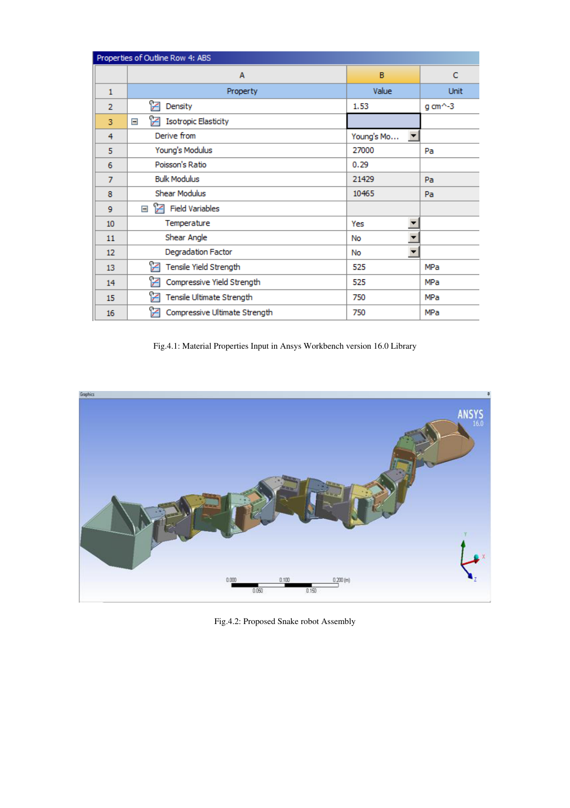
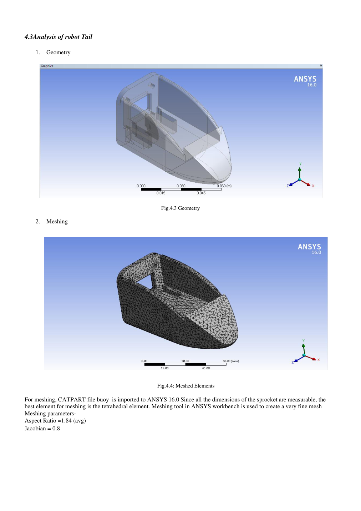
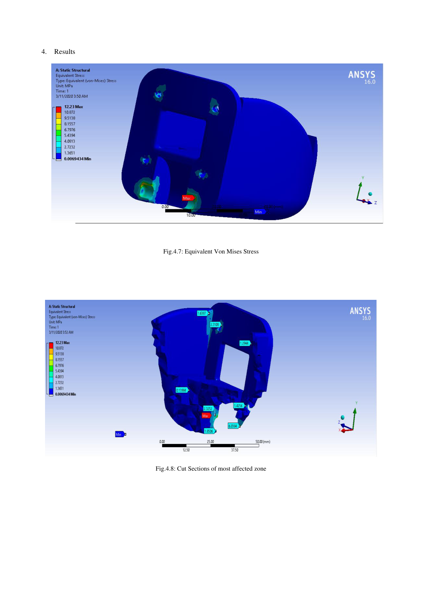
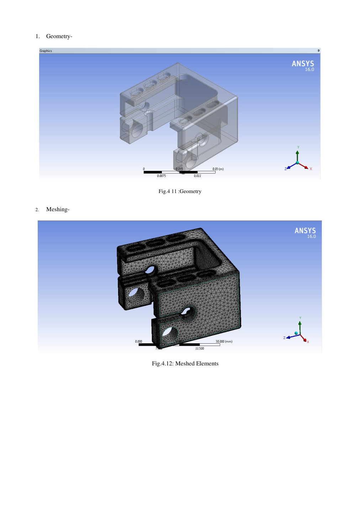
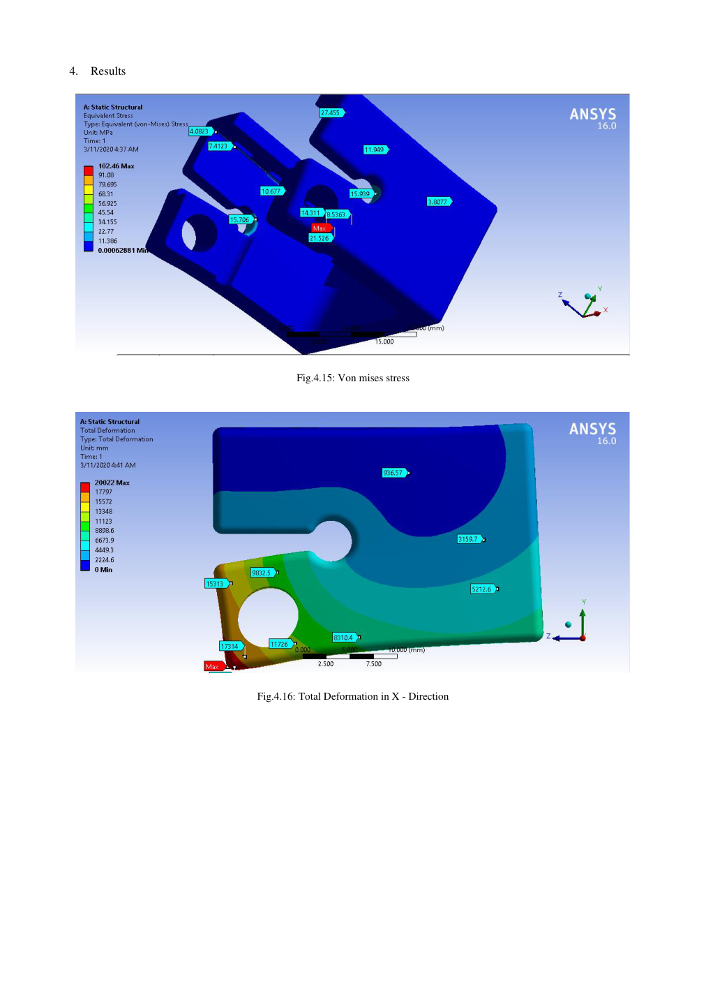
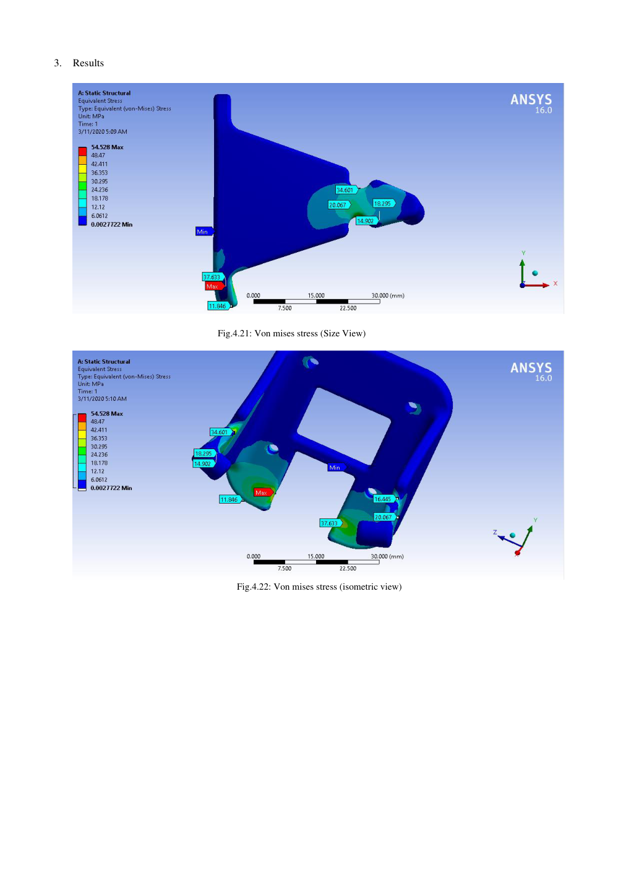
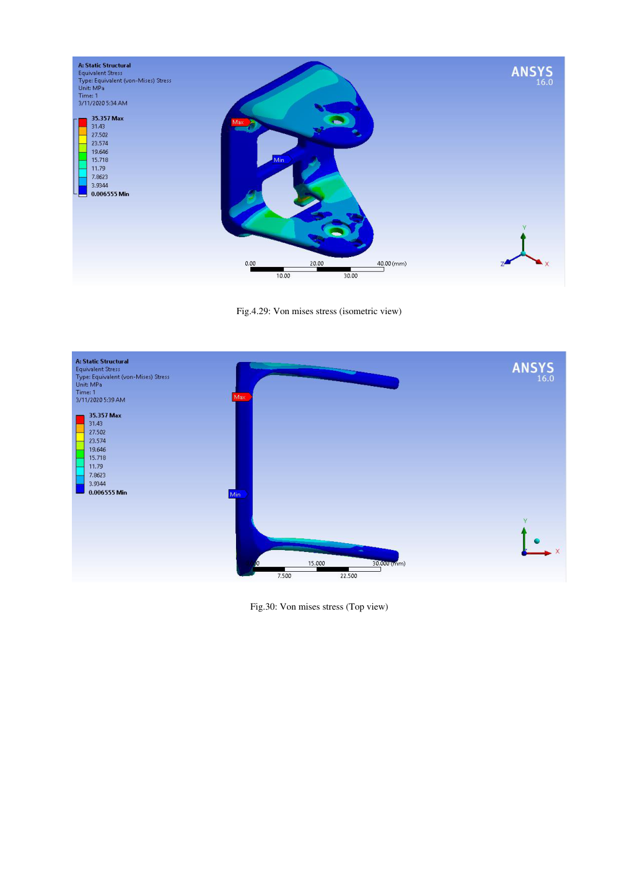

# 🐍 Design and Analysis of a Snake-Like Robot

**Biomimetic Robotics · Mechanical Design · CAD · Finite Element Analysis · ANSYS Workbench 16.0**

> A 2020 research project investigating a modular snake-like robot inspired by biological lateral undulation, with component-level structural analysis.



## Project at a glance

| Area | Details |
|---|---|
| Domain | Biomimetic / modular robotics |
| Locomotion concept | Lateral undulation (serpentine crawling) |
| Structural material considered | ABS plastic |
| FEA tool | ANSYS Workbench 16.0 |
| CAD deliverables in original archive | Creo/Pro-E `.prt.1` and IGES `.igs` files |
| Study year | 2020 |
| Research output | *Design and Analysis of Snake Like Robot* |

## Engineering objective

Investigate a modular, articulated robotic platform that imitates the wave-like motion of a biological snake. The work combines mechanical architecture, a discussion of serpentine locomotion, simulation parameters, and virtual structural validation of individual parts.

## Mechanical architecture

The design comprises a **head**, **modular articulated segments**, and a **tail**. The study discusses servo-actuated link motion and considers electronics integration in the head and battery placement in the tail.

## Locomotion and simulation

The paper describes lateral undulation and cites a MATLAB `ode15s`-based simulation environment. Its reported parameter table includes **8 links**, **40° slithering amplitude**, **80°/s joint-angle frequency**, and **45° phase shift**. These are **reported study parameters**, not independently rerun results from files in this repository.

## Finite element analysis (FEA)

ANSYS Workbench 16.0 was used for geometry inspection, tetrahedral meshing, load/boundary-condition setup, and stress/deformation visualization. The figures below are reproduced from the uploaded 2020 paper.

### Tail: geometry, mesh, and stress




### Base: geometry, mesh, and stress




### Articulated links




### Reported peak equivalent (von Mises) stress

| Analyzed component | Reported maximum stress |
|---|---:|
| Tail | 12.23 MPa |
| Base | 102.00 MPa |
| Link 01 | 54.28 MPa |
| Link 02 | 35.3 MPa |

**Engineering caveat:** These values are transcribed from the paper, not independently validated. The paper describes the components as safe, but a defensible safety factor requires verifying the actual ABS grade, yield/ultimate properties, load cases, units, and failure criteria. In particular, do not treat the 102 MPa base result as proven safe without additional verification.

## Research paper

**Title:** *Design and Analysis of Snake Like Robot* (2020)  
**Authors:** Shraddha Heganna, Aishwarya Mali, Shivam Jha, and Prof. G. S. Dave  
**Institution:** Smt. Kashibai Navale College of Engineering, Pune, India  

📄 [Read the research paper (PDF)](paper/Design_and_Analysis_of_Snake_Like_Robot_2020.pdf)

## Repository layout

```text
.
├── README.md
├── assets/                 # Original research-paper figure pages
├── cad/                    # Instructions for adding original CAD files
│   └── README.md
└── paper/                  # Research paper PDF
```

## CAD file availability

The original archive supplied for this project contains native CAD part files and IGES exports. They are **not yet included in this starter repository**; see [`cad/README.md`](cad/README.md) for the inventory and upload instructions.

## Citation

Heganna, S., Mali, A., Jha, S., & Dave, G. S. (2020). *Design and Analysis of Snake Like Robot*. Research paper supplied with this repository.
